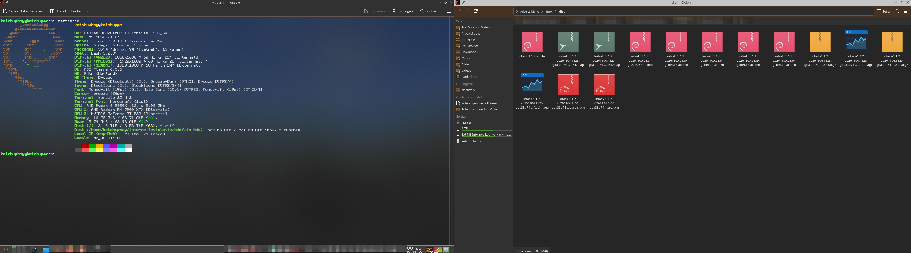
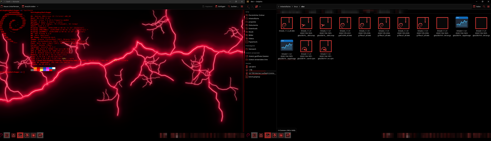
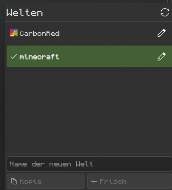
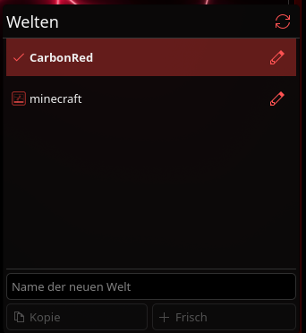

# Multitheme

Mehrere komplette KDE-Plasma-„Welten“ auf einem Rechner: Panels, Hintergrund,
Farben, Icons, Akzentfarbe, Terminal-Einstellungen und Autostart – mit einem
Klick umschalten.

*English below.* · KDE Store: <https://store.kde.org/p/2381234/>




<p>
  
  
</p>

## Installation (Plasma 6)

1. `multitheme.plasmoid` aus den
   [Releases](../../releases/latest) herunterladen.
2. Rechtsklick auf die Kontrollleiste → **Miniprogramme hinzufügen** →
   **Neue Miniprogramme holen** → **Aus lokaler Datei installieren …**
3. **Multitheme** in die Kontrollleiste ziehen.

Alternativ im Terminal:

```sh
kpackagetool6 -t Plasma/Applet -i multitheme.plasmoid
```

Oder direkt über **Neue Miniprogramme holen** nach „Multitheme“ suchen.

Voraussetzungen: Plasma 6 und `python3` (ist auf praktisch jeder Distribution
installiert).

## Benutzung

- **Erster Start:** Namen eingeben → *Als erste Welt speichern*. Dein jetziger
  Desktop ist dann deine erste Welt.
- **Kopie:** neue Welt als Kopie der aktuellen – zum Weiterbasteln.
- **Frisch:** neue Welt mit Standard-Breeze, ohne deine Anpassungen.
- Klick auf eine Welt wechselt dorthin (die Plasma-Shell startet dabei kurz neu).
- Stift-Symbol: umbenennen.

## Wie es funktioniert

Jede Welt ist ein Ordner unter `~/.local/share/multitheme/worlds/` mit Kopien
der Plasma-Konfigurationsdateien. Beim Wechsel wird die aktuelle Welt
gespeichert und die Dateien der Zielwelt zurückgespielt. Vor dem allerersten
Eingriff wird ein Backup unter `~/.local/share/multitheme/original-backup.tar.gz` angelegt.

## Kommandozeile (optional)

Das Skript liegt im Widget unter
`~/.local/share/plasma/plasmoids/org.multitheme.switcher/contents/code/multitheme`.
`python3 …/multitheme install` legt `~/.local/bin/multitheme` und einen
Menüeintrag an. Befehle: `list`, `switch NAME`, `new NAME [--frisch]`,
`rename ALT NEU`, `delete NAME`, `save`, `next`.

## Selbst bauen

```sh
./build.sh
```

---

## English

Keep several complete Plasma desktops ("worlds") and switch between them with
one click. A world is not just the global theme, but panels and their widgets,
wallpaper, colours, icons, fonts, window decorations, cursor, splash and lock
screen, GTK/Kvantum styling, Konsole profiles and autostart entries.

- Save your current desktop as your first world
- New world as a copy of the current one, or a fresh default Breeze world
- Rename and delete worlds
- A backup of your original configuration is created before the first change
- Optional command line tool (`multitheme list / switch / new / next …`)

Install: download `multitheme.plasmoid` from the
[releases](../../releases/latest), then right-click the panel → *Add Widgets* →
*Get New Widgets* → *Install Widget From Local File…*, or
`kpackagetool6 -t Plasma/Applet -i multitheme.plasmoid`.

Requirements: Plasma 6, python3.

## Lizenz / License

GPL-2.0-or-later, siehe [LICENSE](LICENSE).
